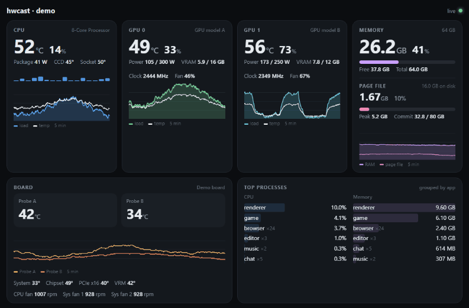
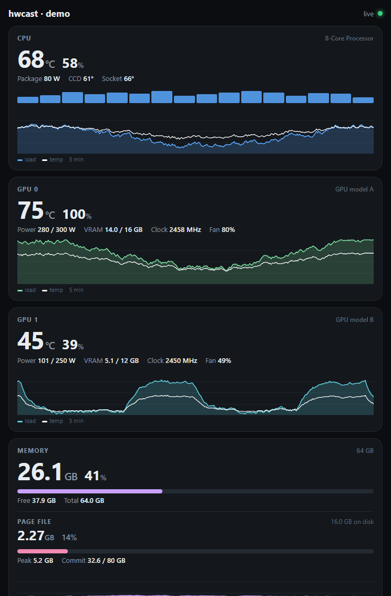

# hwcast

[](https://www.rust-lang.org/)
[](#requirements)
[](#hardware-support)
[](LICENSE)
[](https://github.com/ShreyamMaity/hwcast/stargazers)
[](https://github.com/ShreyamMaity/hwcast/network)
[](#ai-agents-mcp)
[](#mods)
[](https://shreyammaity.github.io/hwcast/demo/)
[](https://shreyammaity.github.io/hwcast/setup/)

A tiny Windows service that serves a live hardware dashboard for your PC to any browser on your network: CPU, every NVIDIA GPU, RAM, page file, motherboard temperatures, fans and the apps using the most resources, updated every second. It also feeds the same data to AI agents through a built-in MCP server and to mods like small displays.

Nothing to install on the viewing device. Open the address in any browser on your local network (a laptop, a spare monitor, a tablet, a phone) and leave it open.

The same live data goes beyond the browser:

- **[AI agents (MCP)](#ai-agents-mcp)**: a built-in MCP server lets Claude Code, Codex, Cursor and other agents read your hardware, find a free GPU or wait for a job to finish.
- **[Mods](#mods)**: separate programs can subscribe to the stream and show it anywhere, like the [GCB200 bracket display](https://github.com/ShreyamMaity/hwcast-gcb200) mod.

**[Try the live demo](https://shreyammaity.github.io/hwcast/demo/)**: the real dashboard running on made-up data, right in your browser.



## Features

- **One exe, one double-click**: installs itself as a Windows service that starts at boot. No installer framework, no runtime.
- **Every GPU detected automatically**: each NVIDIA card gets its own panel and graph, numbered the same way as `nvidia-smi`.
- **Real sensors**: CPU temperature and package power, motherboard temperatures, fans and your own thermistor probes, read directly through the signed PawnIO driver.
- **Costs nothing when nobody is watching**: sensors are only read while a dashboard is open. 0% CPU and about 0.2 MB of RAM otherwise.
- **Local network by default**: any device at home can open it, nothing is exposed to the internet. Works through Tailscale or any VPN for access from elsewhere.
- **Mods**: a versioned live stream that other programs can build on: small displays, LED strips, home automation. See [Mods](#mods).
- **Built for AI agents too**: an MCP server is built in, so Claude Code, Codex, Cursor and other agents can check temperatures, find a free GPU or wait for a job to finish. See [hwcast for AI agents](#ai-agents-mcp).
- **Plain commands**: `hwcast status`, `start`, `stop`, `open`, `uninstall`. Start and stop need no admin prompt.

## Quick start

**Option 1: download and double-click**

1. Download `hwcast.exe` from the [latest release](https://github.com/ShreyamMaity/hwcast/releases/latest).
2. Double-click it, answer `Y`, and approve the Windows admin prompt.
3. The dashboard opens in your browser. The installer also prints the address to open on your other devices, for example `http://192.168.1.20:8340`.

**Option 2: let your AI coding agent set it up**

Click [**Setup with an agent**](https://shreyammaity.github.io/hwcast/setup/) and pick yours: Claude Code (one click), Codex, Antigravity, Grok Build, or any other agent that can run PowerShell. It starts with a prepared prompt; the agent checks your hardware, asks a few questions (port, where you will view the dashboard, sensor driver, install folder, connecting AI agents) and installs hwcast once you confirm. The steps it follows are in [docs/agent-setup.md](docs/agent-setup.md).

Or paste this prompt into any coding agent yourself:

```text
Set up hwcast on this Windows PC for me. Read the setup guide at https://raw.githubusercontent.com/ShreyamMaity/hwcast/main/docs/agent-setup.md (if you cannot browse, download it in PowerShell with: irm <that URL>) and follow it exactly: check my system first, ask me the setup questions, and wait for my answers before changing anything.
```

**Option 3: winget and MSI** are planned for the next release.

## Commands

After installing, `hwcast` works in any new terminal.

| Command | Does |
|---|---|
| `hwcast status` | Service state, sensor driver, and the dashboard addresses for this PC, your network and your VPN |
| `hwcast open` | Opens the dashboard in your browser |
| `hwcast start` / `stop` / `restart` | Controls the service. Stopping lasts until the next boot |
| `hwcast install [--port 9000] [--dir D:\Tools\hwcast]` | Installs or updates. Run a newer `hwcast.exe` the same way to upgrade; your config is kept |
| `hwcast uninstall [--keep-config]` | Removes everything. Also available in Settings > Apps |
| `hwcast run` | Runs in the foreground instead of as a service |
| `hwcast mcp` | MCP server for AI agents on stdin and stdout. Agents start it themselves, see [below](#ai-agents-mcp) |
| `hwcast --once` | Prints every sensor as JSON (run as admin). Useful to find sensor IDs |

The installer adds a **hwcast** entry to the Start menu that opens the dashboard, and an entry in **Settings > Apps** for uninstalling.

## Use case: a tablet as a dedicated stats screen

An old iPad, an Android tablet or a spare phone makes a great always-on hardware monitor next to your desk: glance at temperatures and GPU load during a game, a render or a training run without alt-tabbing to Task Manager.

Want to see how it looks first? Open the [live demo](https://shreyammaity.github.io/hwcast/demo/) on the tablet.

1. On the tablet, open the address from `hwcast status`, for example `http://192.168.1.20:8340`.
2. Add it to the home screen. On iPad or iPhone: Share, then **Add to Home Screen**. On Android: browser menu, then **Add to Home screen** or **Install app**. It then opens full screen, without browser bars.
3. Keep the screen on. The dashboard asks the browser to keep the screen awake while it is open (tap it once if the screen still dims). On iPad you can also set **Settings > Display & Brightness > Auto-Lock > Never**, or use **Guided Access** to lock the tablet to the dashboard.
4. Leave it on its charger. The dashboard reconnects by itself if the PC sleeps or restarts.

The layout adapts from a phone in portrait up to a tablet in landscape. Two GPUs, CPU and memory fit on one iPad mini screen in landscape; in portrait the cards stack and scroll.



## Viewing it away from home

hwcast only answers your local network by default. To see it from elsewhere, use whatever you already use to reach your home network.

### Optional: Tailscale

[Tailscale](https://tailscale.com) is the easiest way to keep the dashboard working on your phone or tablet anywhere, with nothing exposed to the internet. hwcast already allows Tailscale addresses, so there is nothing to configure on the hwcast side.

1. Install Tailscale on the PC and on the viewing device, and sign in to the same account on both.
2. Run `hwcast status` on the PC. It prints a `100.x.y.z` address next to "Tailscale / VPN".
3. Open `http://100.x.y.z:8340` on the device. With MagicDNS on, `http://<your-pc-name>:8340` works too.

The connection is encrypted by Tailscale end to end. Anyone you share your tailnet with can see the dashboard, so use Tailscale ACLs if that matters.

### Other options

- **Another mesh VPN** such as ZeroTier or WireGuard. Addresses in `100.64.0.0/10` are allowed by default; for other ranges, add them to `allow` in `config.json`.
- **A reverse proxy** (Caddy, nginx, Traefik) in front of `http://<PC>:8340`. Put HTTPS and a login in front of it if it faces the internet, since hwcast has no login of its own.

## Footprint

| | Measured |
|---|---|
| CPU while nobody is watching | 0% (sensors are not read at all) |
| Memory while nobody is watching | about 0.2 MB resident |
| CPU while a dashboard is open | about 1.3% of one core |
| Memory while a dashboard is open | about 23 MB (mostly the NVIDIA library) |
| Network | about 1 KB per second per viewer |
| Download | one exe, about 730 KB |

## What it shows

- **CPU**: temperature (Tctl), per CCD temperatures, package power, total and per thread load, 5 minute graph
- **GPUs** (NVIDIA): temperature, hotspot and memory temperature where the card reports them, load, power vs limit, VRAM, clock and fan speed for every card, each with its own graph
- **Memory**: RAM used and free, page file in use and peak, commit charge, graph of both
- **Board**: motherboard temperatures, fan speeds, and external thermistor probes as large tiles
- **Top processes**: by CPU and by memory, grouped by app the way Task Manager groups them

## Requirements

- Windows 10 or 11, x64
- A browser on any device on the same local network (or on the PC itself at `http://localhost:8340`)
- [PawnIO](https://pawnio.eu) driver for CPU temperature and motherboard sensors. The installer offers to install it with winget. Without it, load, memory, GPUs and processes still work

### Hardware support

| Part | Supported |
|---|---|
| CPU temperature and power | AMD Ryzen (Zen 1 to Zen 5) |
| CPU load, RAM, page file, processes | Any |
| GPU | NVIDIA, any number of cards (through NVML, ships with the driver) |
| Motherboard sensors | ITE Super I/O chips: IT8613E, IT8628E, IT8686E, IT8688E, IT8689E, IT8696E, IT87952E, IT8792E (most Gigabyte boards) |

Board channels on Gigabyte AM5 boards (X870, X870E, B850 with IT8696E) get proper names. Other supported chips show numbered channels ("IT8686E temp 3") that you can rename in `config.json`. Unsupported parts are simply hidden on the dashboard.

Not supported yet: Intel CPU temperatures, AMD and Intel GPUs, Nuvoton Super I/O chips (most ASUS, MSI and ASRock boards). Pull requests welcome.

## Configuration

Optional `config.json` in the install folder (default `C:\Program Files\hwcast`). Run `hwcast restart` after editing it. See [config.example.json](config.example.json).

```json
{
  "bind": ["0.0.0.0:8340"],
  "allow": ["127.0.0.0/8", "10.0.0.0/8", "172.16.0.0/12", "192.168.0.0/16", "100.64.0.0/10"],
  "labels": { "it8696e.t5": "Between GPUs" },
  "probes": ["it8696e.t5", "it87952e.t1"],
  "hide": ["it8696e.f5"]
}
```

| Key | Meaning |
|---|---|
| `bind` | Addresses to listen on. `hwcast install --port` sets this for you |
| `allow` | IPv4 ranges allowed to connect. Default is this PC, the private LAN ranges and `100.64.0.0/10` (Tailscale and similar VPNs). Narrow it, for example to `["127.0.0.0/8", "192.168.1.0/24"]`, to allow only your own subnet |
| `labels` | Rename any sensor. IDs look like `it8696e.t5` (chip, temperature channel 6) or `it8696e.f0` (chip, fan 1). `hwcast --once` lists them all |
| `probes` | Sensors to show as large tiles with their own graph, meant for thermistor probes you placed yourself |
| `hide` | Sensors to leave out |

## How it works

```
sensors (PawnIO, NVML, Windows)  >  hwcast service  >  Server-Sent Events over your network  >  browser
```

- The service serves one HTML page and a `/events` stream. The browser keeps that stream open and receives one small JSON update per second, then draws everything locally. History lives in the browser, nothing is written to disk.
- Sensors are read only while at least one viewer is connected. When the last one leaves, the NVIDIA library is unloaded and memory is handed back to Windows.
- CPU and board sensors are read through PawnIO, a signed driver that runs small sandboxed modules for port and register access. hwcast only reads sensors and never writes fan or voltage settings. It holds the same bus locks HWiNFO, LibreHardwareMonitor and vendor tools use, so they can run at the same time.
- No WMI, no polling of other tools, no telemetry of its own.

`/api/now` returns one JSON snapshot, handy for scripts and home automation. `/mcp` serves the same data to AI agents ([docs/mcp.md](docs/mcp.md)).

## AI agents (MCP)

hwcast has a built-in [MCP](https://modelcontextprotocol.io) server, so AI agents can read your hardware live. It is read only: agents can look, never change anything.

On this PC (Claude Code shown; Codex, Cursor, Claude Desktop and VS Code are in the guide):

```
claude mcp add --scope user hwcast -- hwcast mcp
```

From another machine on your network or tailnet:

```
claude mcp add --scope user --transport http hwcast http://192.168.1.20:8340/mcp
```

| Tool | Does |
|---|---|
| `get_summary` | CPU, every GPU, RAM and the busiest apps in one compact reading |
| `get_cpu`, `get_gpus`, `get_memory`, `get_sensors`, `get_processes` | Detail for one area |
| `check_gpu_free` | Watches the GPUs for a few seconds and says which one is free for a job that needs a given amount of VRAM |
| `sample` | Min, average and max of any metrics over up to a minute |
| `wait_for` | Waits until a metric drops below or rises above a value, for example until a render finishes or a GPU cools down |
| `list_metrics`, `get_snapshot` | Every metric name with its value, and the raw snapshot |

Setup for every client, metric names and protocol details: [docs/mcp.md](docs/mcp.md).

## Mods

Mods are separate programs that read the same `/events` stream and send the data somewhere else: a small display, an LED strip, a home automation hub. hwcast itself stays read only and knows nothing about them. The stream format is versioned and documented in [docs/mods.md](docs/mods.md).

| Mod | What it does |
|---|---|
| [hwcast-gcb200](https://github.com/ShreyamMaity/hwcast-gcb200) | Shows two live values with load bars on the Ant Esports GCB200 GPU bracket display |

Built one? Open a pull request that adds it to this table.

## Security

- Only this PC, your local network and VPN addresses (`100.64.0.0/10`) can connect by default. hwcast checks this itself, and the installer's firewall rule enforces it too. Nothing is opened to the internet.
- Read only. There is nothing to control on the dashboard, and the MCP tools for agents only read too.
- The MCP endpoint refuses requests from web pages served by other sites, so a page you visit cannot use it to read your PC.
- No login. Anyone on your local network can see the dashboard (hardware stats and the names of running apps). If that matters, narrow `allow` in `config.json`.
- Plain HTTP. That is fine on a home network or inside a VPN tunnel. Use a reverse proxy with HTTPS and authentication if you expose it any further.
- The service runs as LocalSystem because reading CPU and motherboard sensors needs it. Interactive users can start and stop it; only administrators can install, change or remove it.

## Tech Stack

| Layer | Technology |
|-------|-----------|
| Language | [Rust](https://www.rust-lang.org/) (2021 edition), single static exe |
| Sensor access | [PawnIO](https://pawnio.eu) signed driver with [PawnIO.Modules](https://github.com/namazso/PawnIO.Modules) |
| GPU | [NVML](https://developer.nvidia.com/management-library-nvml) through [nvml-wrapper](https://crates.io/crates/nvml-wrapper) |
| Windows APIs | [windows-sys](https://crates.io/crates/windows-sys), [windows-service](https://crates.io/crates/windows-service) |
| Web server | Hand-written HTTP + Server-Sent Events on `std::net` (no async runtime) |
| UI | Vanilla HTML/CSS/JS and canvas, embedded in the exe (no build step) |

## Build from source

```powershell
git clone https://github.com/ShreyamMaity/hwcast
cd hwcast
powershell -File scripts\fetch-modules.ps1   # downloads the PawnIO modules into vendor\mods
cargo build --release                        # target\release\hwcast.exe
```

`scripts\package.ps1` builds the release assets (`hwcast.exe`, a zip with the licenses, and `SHA256SUMS.txt`).

## Code signing policy

Releases are not code signed yet, so Windows SmartScreen may warn the first time you run `hwcast.exe` ("Windows protected your PC"). Click **More info**, then **Run anyway**. To check a download yourself, compare `Get-FileHash hwcast.exe` with the line in the release's `SHA256SUMS.txt`.

- Every release is built from this repository's source by [GitHub Actions](.github/workflows/release.yml) on GitHub-hosted runners. Nothing is built or uploaded by hand.
- Team roles:
  - Committers and reviewers: [Shreyam Maity](https://github.com/ShreyamMaity)
  - Approvers: [Shreyam Maity](https://github.com/ShreyamMaity)
- Contributions from people outside the team are reviewed before they are merged.
## Privacy

hwcast does not send any information to other networked systems. It serves the dashboard only to devices that open it (this PC, your local network and VPN addresses by default) and has no telemetry, analytics or update checks. The only outbound connection is optional and happens during installation, when you agree to install the PawnIO driver through winget.

## Credits

- [PawnIO](https://pawnio.eu) and [PawnIO.Modules](https://github.com/namazso/PawnIO.Modules) by namazso, for safe sensor access on Windows
- [LibreHardwareMonitor](https://github.com/LibreHardwareMonitor/LibreHardwareMonitor), whose Super I/O and Ryzen code this follows
- See [THIRD_PARTY_NOTICES.md](THIRD_PARTY_NOTICES.md) for licenses

## License

MIT. The embedded PawnIO modules are LGPL-2.1, see [THIRD_PARTY_NOTICES.md](THIRD_PARTY_NOTICES.md).
